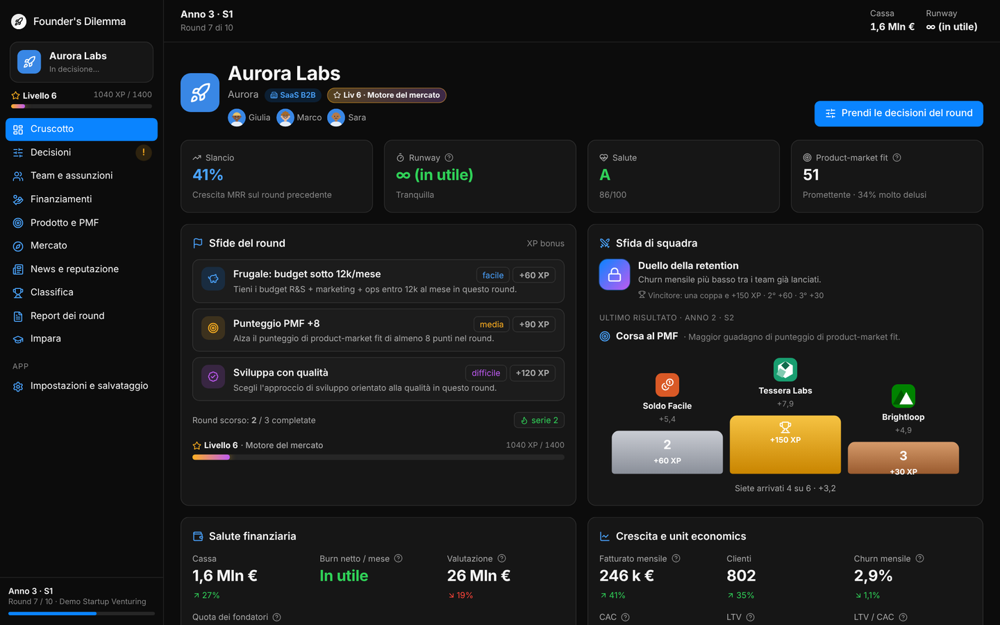
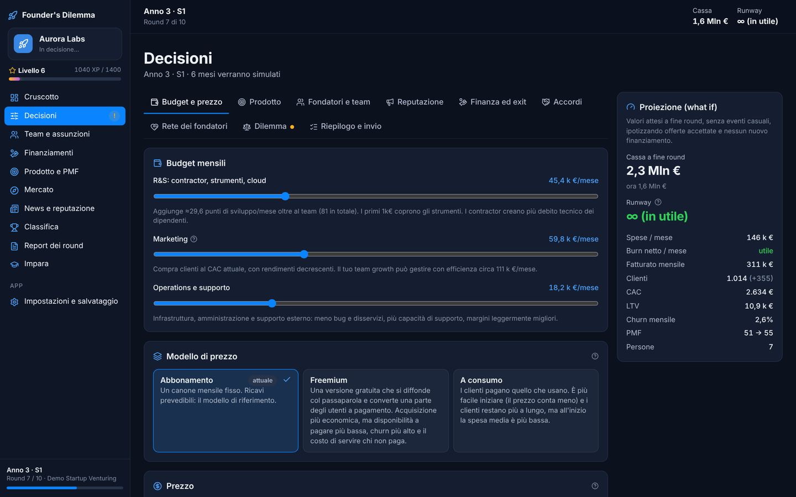
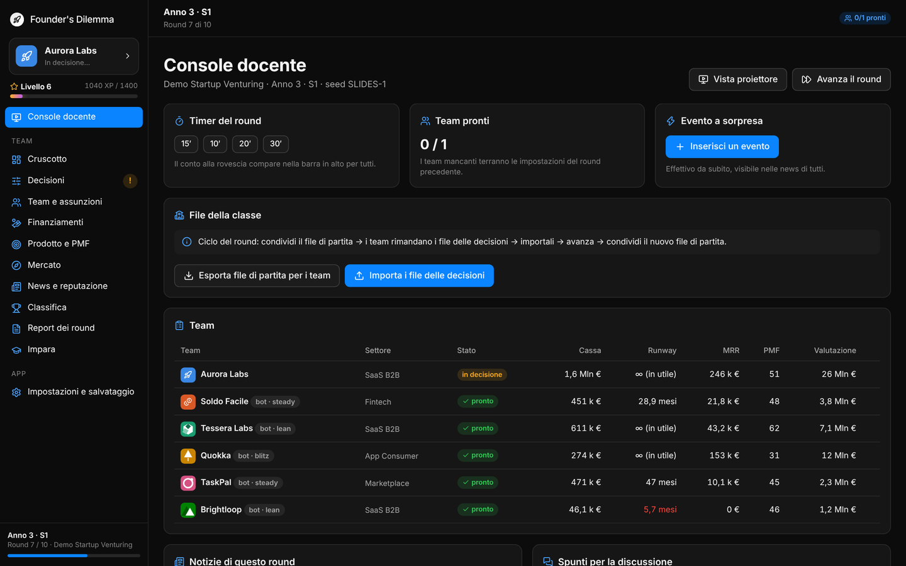
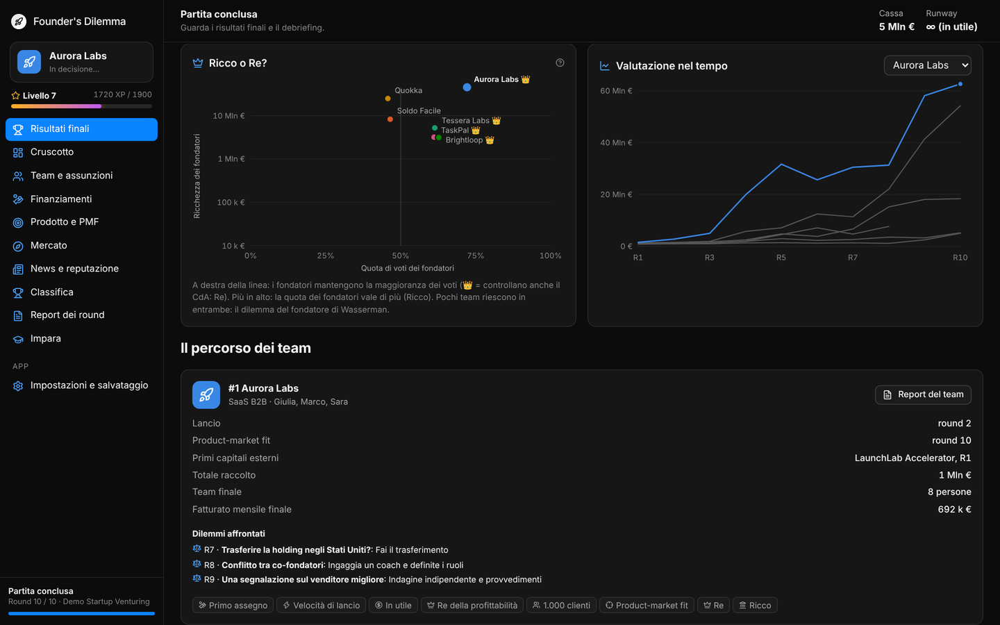
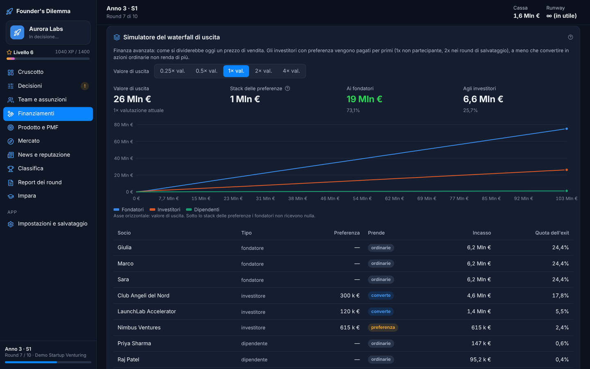

# Founder's Dilemma

**Business game di startup venturing per l'aula universitaria.** I team fondano una startup, cercano il product-market fit, assumono, raccolgono capitali e affrontano i dilemmi del fondatore (ricco o re?), da soli contro i bot oppure in classe, round dopo round.

Gira su **macOS** (Apple silicon e Intel), **Windows** e, come file unico, in **qualsiasi browser**. Interfaccia in italiano e inglese.

**Gioca subito online: [kurisuchanxxx.github.io/foundersdilemma](https://kurisuchanxxx.github.io/foundersdilemma/)** (nessuna installazione, funziona anche da smartphone).



> English summary at the bottom of this page.

## Indice

- [Cosa si impara](#cosa-si-impara)
- [Installazione](#installazione)
- [Modalità di gioco](#modalità-di-gioco)
- [Materiali per il corso](#materiali-per-il-corso)
- [Sviluppo](#sviluppo)
- [Architettura](#architettura)
- [Pubblicare una nuova versione](#pubblicare-una-nuova-versione)
- [English](#english)

## Cosa si impara

Ogni meccanica del gioco corrisponde a un concetto del corso, con la relativa scheda nella sezione **Impara** dell'app:

| Area | Nel gioco | Riferimenti |
|---|---|---|
| Lean startup e customer discovery | MVP, interviste, smoke test, pivot | Ries, Blank |
| Product-market fit | Punteggio PMF e test di Sean Ellis (40% molto delusi) | Ellis, Andreessen |
| Diffusione dell'innovazione | Segmenti di Rogers, chasm alla maggioranza anticipatrice | Rogers, Moore |
| Unit economics | CAC, LTV, churn, payback, margine lordo, elasticità del prezzo | |
| Finanza della startup | Bandi, prestiti, crowdfunding, SAFE, round prezzati, option pool, waterfall | Feld e Mendelson |
| Team e fondatori | Archetipi, divisione delle quote, vesting e cliff, aste per i talenti | Wasserman |
| Il dilemma del fondatore | 16 dilemmi, controllo del CdA, classifica Ricco o Re | Wasserman |
| Strategia ed etica | Eventi di mercato, reputazione, scelte con conseguenze differite | |

## Installazione

Le versioni pronte si scaricano dalla pagina **Releases** del repository:

| Sistema | File | Note al primo avvio |
|---|---|---|
| macOS 11 o successivo | `Founder’s Dilemma_x.y.z_universal.dmg` | L'app non è firmata da un Apple Developer ID: apri il file, trascina l'app in Applicazioni, poi clic destro sull'app > **Apri** > **Apri**. Su macOS 15 o successivo: Impostazioni di Sistema > Privacy e sicurezza > **Apri comunque**. |
| Windows 10/11 | `..._x64-setup.exe` (consigliato) oppure `.msi` | SmartScreen può mostrare un avviso: **Ulteriori informazioni** > **Esegui comunque**. Il programma d'installazione usa WebView2, già presente su Windows 11. |
| Linux | `.AppImage` o `.deb` | |
| Qualsiasi browser | `FoundersDilemma-web.html` | Un unico file che si apre con un doppio clic, anche offline. Comodo da caricare su Moodle o su una cartella condivisa. |

I salvataggi restano sul computer (database locale dell'app o del browser) e si possono esportare come file `.fdgame.json` dalla schermata **Impostazioni e salvataggio**.

Per firmare le app (niente avvisi al primo avvio) servono un certificato Apple Developer e uno per Windows: si configurano come secret del repository seguendo la [guida di Tauri](https://v2.tauri.app/distribute/sign/macos/).

## Modalità di gioco

| Modalità | Per chi | Come funziona |
|---|---|---|
| **Solo contro bot** | Studio individuale, compiti a casa | Un team contro concorrenti AI con tre stili (lean, steady, blitz). |
| **Hot-seat** | Aula con un solo computer o un proiettore | I team si alternano sullo stesso computer. Una schermata di privacy nasconde i dati finché il team non li apre; il docente avanza i round dalla console (protetta da PIN). |
| **Classe (file)** | Ogni team con il proprio portatile | Nessun server: il docente condivide il file di partita, ogni team rimanda un piccolo file di decisioni, il docente li importa, avanza il round e condivide il nuovo file. |

La console docente offre timer del round, vista proiettore, eventi a sorpresa, spunti di discussione ed esportazioni CSV (storico, classifica, decisioni) per la valutazione. Con lo stesso **seed** due classi giocano esattamente lo stesso mercato.

### Schermate

| Decisioni del round con proiezione | Console del docente (modalità Classe) |
|---|---|
|  |  |
| **Debriefing finale: Ricco o Re?** | **Simulatore del waterfall (complessità Avanzata)** |
|  |  |

## Materiali per il corso

La cartella [`docs/corso`](docs/corso/README.md) contiene il pacchetto da presentare all'università:

1. [Proposta di modulo](docs/corso/01-proposta-modulo.md): obiettivi formativi (descrittori di Dublino), CFU, struttura e valutazione.
2. [Piano delle sessioni](docs/corso/02-piano-sessioni.md): sei incontri, con teoria, round di gioco e debriefing.
3. [Guida per il docente](docs/corso/03-guida-docente.md): preparazione, conduzione e problemi frequenti.
4. [Manuale dello studente](docs/corso/04-manuale-studente.md).
5. [Valutazione e rubriche](docs/corso/05-valutazione-e-rubriche.md), con i modelli di decision memo e report finale.
6. [Il modello di simulazione](docs/corso/06-modello-di-simulazione.md): formule, parametri e collegamento con la teoria.

## Sviluppo

Requisiti: [Node.js](https://nodejs.org) 22 o successivo. Per l'app desktop anche [Rust](https://rustup.rs) stabile e i [prerequisiti di Tauri](https://v2.tauri.app/start/prerequisites/) (su macOS gli Xcode Command Line Tools, su Windows i Build Tools di Visual Studio con il carico di lavoro C++).

```bash
npm ci                    # dipendenze
npm run dev               # versione web su http://localhost:1420
npm run desktop:dev       # app desktop in sviluppo (Tauri)
npm run desktop:build     # installer per il sistema in uso (src-tauri/target/release/bundle)
npm run build:single      # dist-single/index.html, il gioco in un solo file
npm test                  # test del motore (Vitest)
npm run e2e               # test end-to-end nel browser (con npm run dev avviato)
npm run balance           # simulazione Monte Carlo per il bilanciamento
```

## Architettura

```
src/core/       motore di simulazione deterministico in TypeScript, senza dipendenze dall'interfaccia
  data/         settori, archetipi dei fondatori, investitori, candidati, eventi, dilemmi, obiettivi
  engine/       round mensili, prodotto e PMF, mercato, team e assunzioni, finanza e cap table, valutazione, bot
src/ui/         interfaccia React (viste, componenti, grafici, glossario, testi IT/EN)
src/platform/   salvataggi (IndexedDB) e file (dialoghi nativi su desktop, download nel browser)
src-tauri/      guscio desktop Tauri v2 (Rust): finestra, dialoghi di apertura e salvataggio
tests/          test unitari del motore ed end-to-end (Playwright)
scripts/        bilanciamento Monte Carlo e tracce di partite
legacy/         il blueprint originale in Swift/SwiftUI (VentureSim) e i video del mockup
```

Il motore è una funzione pura dello stato e delle decisioni: ogni estrazione casuale usa un generatore con seed derivato da (seed della partita, round, scopo, azienda), quindi le partite si possono riprodurre, confrontare tra classi e verificare.

## Pubblicare una nuova versione

1. Aggiorna la versione in `package.json`, `src-tauri/Cargo.toml` e `src-tauri/tauri.conf.json`.
2. Crea e pubblica un tag: `git tag v2.0.0 && git push origin v2.0.0`.
3. Il workflow **Desktop apps** compila macOS (universale), Windows e Linux e crea una release in bozza con gli installer e il file web. Controlla la bozza e pubblicala.

Il workflow **CI** controlla tipi, test unitari, build e test end-to-end a ogni push. Il workflow **Web version on GitHub Pages** pubblica la versione browser sul branch `gh-pages` a ogni push su `main` (oppure a mano da Actions); il sito è servito da GitHub Pages.

## English

**Founder's Dilemma** is a startup venturing business simulation for university courses. Teams found a startup, search for product-market fit, hire, raise money and face the founder's dilemmas (Rich vs King), solo against bots, hot-seat on one computer, or as a class exchanging files with the instructor (no server needed). It runs on macOS, Windows, Linux and in any browser as a single HTML file, in English and Italian.

- **Download**: see the repository Releases (unsigned builds: on macOS right click > Open; on Windows SmartScreen > More info > Run anyway).
- **Develop**: `npm ci`, `npm run dev` (web) or `npm run desktop:dev` (Tauri, needs Rust), `npm test`, `npm run e2e`.
- **Teach**: the course package (Italian) is in [`docs/corso`](docs/corso/README.md): module proposal, session plan, instructor guide, student manual, assessment rubrics and the simulation model.

The deterministic TypeScript engine (`src/core`) is a rewrite and expansion of the original Swift/SwiftUI blueprint kept in `legacy/`.
